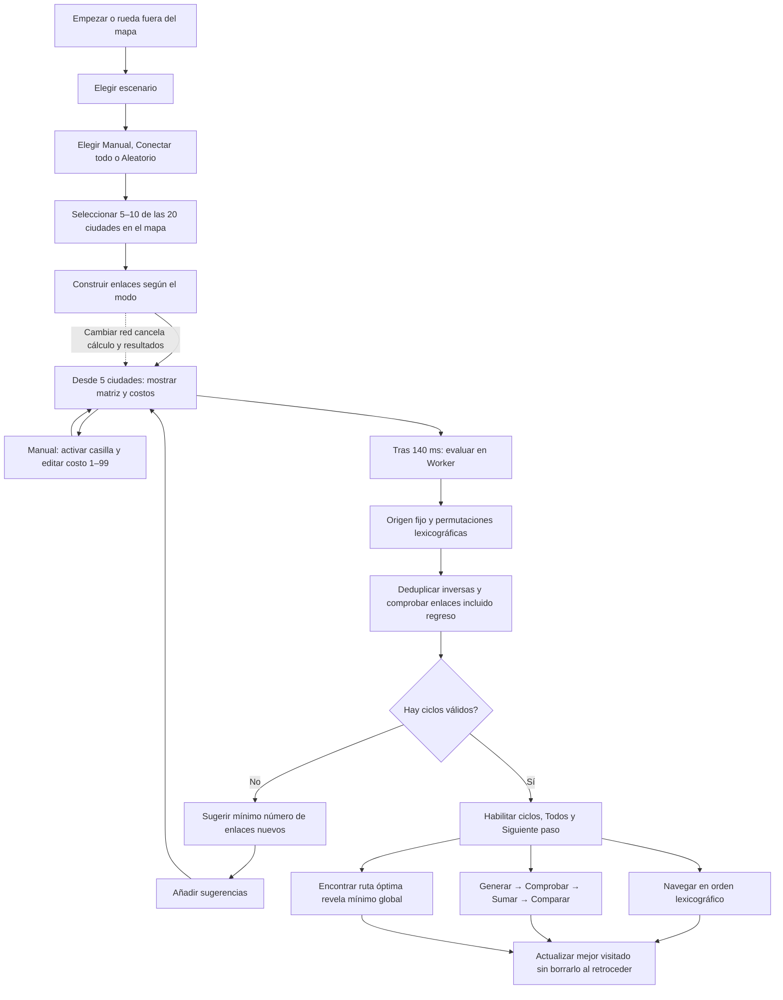

# Flujo de SILKNODE en PC

En Manual, tras seleccionar al menos cinco ciudades, pulsar una casilla fuera de la diagonal activa su enlace con el costo por defecto. Se puede escribir un entero de 1 a 99; ambas casillas simétricas, el mapa y el cálculo se actualizan. Dos clics en ciudades elegidas también alternan un enlace. Mayús + clic elimina una ciudad; la papelera limpia el mapa y los costos personalizados. Conectar todo y Aleatorio generan enlaces al seleccionar ciudades; pulsar Aleatorio de nuevo regenera solo enlaces. No se garantiza un ciclo.

Los costos por defecto se normalizan contra los 190 pares del escenario completo y permanecen fijos entre 1 y 90. Fuera de Manual se usan esos valores; al volver a Manual se recuperan las ediciones de la sesión. La matriz y el recorrido se mantienen a la izquierda; la matriz se oculta con menos de cinco ciudades. La navegación por pasos es manual y utiliza la traza completa, independiente de la búsqueda. La rueda dentro del mapa hace zoom; fuera alterna portada y planificador. La sesión no se guarda ni exporta.
