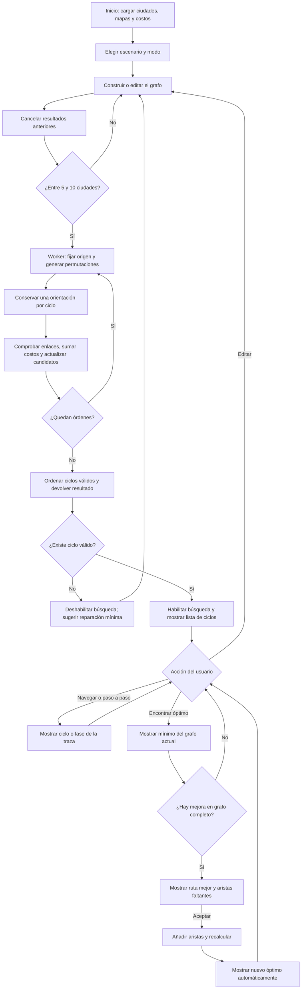

# SILKNODE: información técnica para preparar el informe

Versión revisada: 4 de noviembre de 2026. Este archivo reúne información del código y orientaciones para documentarlo; no sustituye la redacción del informe, las conclusiones del equipo ni la sustentación.

## 1. Qué problema resuelve realmente

SILKNODE representa una red ferroviaria hipotética mediante un grafo simple, no dirigido y ponderado. Cada vértice es una ciudad; cada arista es una conexión permitida; su peso es un costo simulado en millones de dólares (M USD). Se busca un circuito de costo mínimo que visite todas las ciudades seleccionadas exactamente una vez y regrese al origen: un ciclo hamiltoniano mínimo, correspondiente al problema del agente viajero sobre las conexiones disponibles.

La aplicación tiene cinco escenarios independientes: China, Europa, Estados Unidos, Rusia y Perú, con 20 ciudades en cada uno. La construcción admite desde una ciudad y dibuja aristas desde dos. La resolución exige entre 5 y 10 ciudades. Los lugares conservan coordenadas geográficas y las conexiones se dibujan rectas; no representan trazados ferroviarios existentes.

Un objetivo general posible, para que el equipo lo adapte, es: **Desarrollar un simulador web que determine, mediante fuerza bruta, el ciclo hamiltoniano de costo mínimo en una red ferroviaria simulada de entre cinco y diez ciudades, mostrando su evaluación y las conexiones necesarias cuando no exista solución.** La rúbrica pide un objetivo general preciso que empiece en infinitivo; no exige agregar objetivos específicos.

Para la introducción, explicar el contexto de conectar ciudades con costos limitados, la abstracción de grafo y el propósito educativo. No afirmar que el sistema calcula presupuestos reales o diseña una obra viable.

## 2. Separación de lógica y presentación

| Archivo | Responsabilidad | Naturaleza |
| --- | --- | --- |
| `src/algorithm.js` | `solve`, `distance`, `edgeKey`, `decode`, `factorial`: enumeración, costos de ciclos, mínimos, empates y reparaciones | Lógica matemática; no manipula HTML |
| `src/graph.js` | `manualClick`: selecciona extremos, agrega aristas únicas, limita a 10 ciudades, rechaza lazos | Lógica de construcción; independiente del mapa |
| `src/weights.js` | `scenarioWeights`, `hash`, `randomSource`, `randomGraph`: pesos predeterminados y generación de conexiones | Lógica de datos y simulación |
| `src/solver.worker.js` | Recibe el grafo, llama a `solve`, comunica progreso/resultado/error | Ejecución en segundo plano |
| `src/main.js` | Estado de la sesión y coordinación de acciones; también genera controles y dibuja el mapa | Mezcla controlador y presentación, identificables por funciones |
| `src/style.css` | Distribución, colores, tipografía, estados, paneles y animaciones CSS | Presentación |
| `public/data/cities.json` | Catálogo de 100 ciudades con identificadores y coordenadas | Datos |
| `public/data/world.geojson`, `subdivisions.geojson` | Límites y subdivisiones cartográficas locales | Datos visuales |
| `tests/*.test.js` | Verificaciones automatizadas del algoritmo, datos, pesos y modo manual | Validación |

En `main.js`, `clickCity`, `toggleCity`, `applyMode`, `analyze`, `invalidate` y `performAction` coordinan la lógica. `renderMap`, `renderCycle`, `renderNavigation`, `renderMatrix`, `layoutLabels` y `renderHelp` presentan el estado. No describir toda la aplicación como una arquitectura de capas físicamente separadas: la lógica matemática sí está aislada, pero el controlador y el renderizado comparten `main.js`.

## 3. Lenguajes, bibliotecas y herramientas

| Tecnología | Versión instalada | Uso real |
| --- | --- | --- |
| JavaScript, módulos ES | Lenguaje del proyecto | Algoritmo, interacción, validación, generación de pesos y Worker |
| HTML y SVG | Estándares del navegador | Estructura, botones, formularios; mapa, nodos y aristas vectoriales |
| CSS | Estándar del navegador | Apariencia, distribución sin scroll de página en PC y transiciones |
| D3 | 7.9.0 | Proyecciones geográficas, rutas cartográficas, selección SVG y zoom; **no resuelve el agente viajero** |
| `@fontsource/league-spartan` | 5.3.0 | Fuente empaquetada localmente |
| Vite | 7.3.7 | Servidor de desarrollo y compilación de producción; herramienta de desarrollo |
| Web Workers, TypedArrays, DOM, ResizeObserver, requestAnimationFrame | APIs del navegador | Cálculo separado de la interfaz, datos compactos, controles, adaptación de filas y animación |
| Node.js y `node:test` | Entorno local, no requerido al visitante | Ejecutar herramientas y pruebas |
| GitHub y Vercel | Servicios externos de publicación | Repositorio y alojamiento del compilado estático |

Las versiones se verificaron con `npm ls --depth=0`; el archivo de bloqueo fija la instalación. El proyecto no utiliza React, NumPy, SciPy, una API de IA ni una biblioteca externa que calcule el ciclo. No se necesitan cuentas de usuario ni un servidor de cálculo: el navegador ejecuta el algoritmo. El pequeño lanzador Python sirve archivos para la presentación local; no implementa el solver.

Documentación primaria: [D3](https://d3js.org/), [Vite](https://vite.dev/guide/) y [Web Workers en MDN](https://developer.mozilla.org/en-US/docs/Web/API/Web_Workers_API/Using_web_workers). Estas fuentes explican las herramientas; el funcionamiento particular descrito aquí procede del código del proyecto.

## 4. Representación matemática y estructuras

Se utiliza `G = (V, E, w)`. Los identificadores de las ciudades están en `selected`; las aristas activas se almacenan en un `Set`. Una clave normalizada evita registrar dos veces A–B y B–A:

```js
export const edgeKey = (a, b) => (a < b ? `${a}|${b}` : `${b}|${a}`);
```

La matriz interna es simétrica, de tamaño n × n, y contiene los costos de todos los pares potenciales, incluso los todavía no conectados. La existencia de una conexión la determina `edges`, no que su costo sea cero. La matriz de consulta muestra únicamente los enlaces activos; no es necesaria para operar el programa.

Para un orden `v0, v1, ..., v(n−1), v0`, el costo es la suma de los n tramos, incluido el regreso. Es válido solo si todos esos enlaces pertenecen a E. Un grafo conexo puede no admitir un ciclo hamiltoniano; conectividad por sí sola no basta. El programa comprueba órdenes completos, sin asumir que ser conexo es suficiente.

## 5. Cómo se obtienen los pesos

`scenarioWeights` calcula de forma determinista los 190 pares posibles de las 20 ciudades de cada escenario. Primero obtiene la distancia geográfica de Haversine, usando radio terrestre medio 6371.0088 km. Después usa un hash de la clave de cada pareja para construir factores ilustrativos:

```text
terreno = 0.55 + (h % 196) / 100
infraestructura = 120 + ((h >>> 8) % 1301)
raw = distancia_km × terreno + infraestructura
peso = limitar(round(90 × raw / máximo_del_escenario), 1, 90)
```

Los factores son sintéticos: no se extrajeron de estudios de ingeniería. La normalización usa el escenario entero, no las ciudades seleccionadas, por lo que cambiar de selección no altera los pesos predeterminados. En Manual se pueden sustituir por enteros de 1 a 99. Se rechazan cero, negativos, decimales y valores mayores a 99. La suma de un circuito sí puede superar 99.

Cambiar a Conectar todo o Aleatorio usa los pesos predeterminados. Volver a Manual recupera las modificaciones en la misma sesión y escenario. Limpiar, cambiar de escenario o recargar borra esos cambios. La longitud visual de una línea no determina por sí sola su costo; por eso el mínimo no tiene por qué seguir el contorno exterior de las ciudades.

## 6. Construcción manual, completa y aleatoria

**Manual (`manualClick`).** Un primer clic fija el extremo inicial; el segundo en una ciudad distinta agrega la arista y termina esa pareja. Puede usarse un nodo existente o uno nuevo, y pueden formarse componentes desconectados. Repetir una pareja conserva su arista. Un segundo clic en el mismo nodo cancela la pareja, sin crear un lazo. Al llegar a diez ciudades no se añade una undécima, pero sí se permiten conexiones entre las ya seleccionadas. Mayús + clic permite quitar una ciudad junto con sus aristas.

**Edición (`editEdge` y envío de `edge-editor`).** Pulsar cualquier parte de la arista o su número abre el editor con el costo actual. Guardar valida el entero, actualiza `manualWeights` e invalida los resultados anteriores. El mismo editor permite eliminar la conexión. La representación no dirigida hace que ambos sentidos compartan costo.

**Conectar todo (`complete`).** Recorre todas las parejas con `i < j` y agrega sus claves: n(n−1)/2 aristas. Desde dos ciudades ya puede dibujar un enlace; desde cinco puede resolver.

**Aleatorio (`randomGraph`).** Recorre las parejas y agrega cada arista si el generador seudaleatorio devuelve un valor menor que 0.5. Pulsar Aleatorio obtiene una nueva semilla mediante `crypto.getRandomValues`. La misma selección ordenada y semilla reproducen las conexiones en pruebas. No cambia ciudades ni costos, ni garantiza conectividad o un ciclo. Un grafo aleatorio sin solución es un resultado permitido, no un error.

## 7. Fuerza bruta, paso a paso

1. Validar que haya entre 5 y 10 ciudades y una matriz finita, no negativa y simétrica.
2. Fijar como origen la ciudad de índice 0, correspondiente a la primera seleccionada en el orden del catálogo.
3. Generar recursivamente las permutaciones de los índices 1 a n−1. `used` impide repetir ciudades; al retroceder se libera el índice.
4. Descartar una orientación de cada pareja de ciclos inversos: `if (perm[0] > perm[n - 2]) return;`. Es válido por tratarse de costos y enlaces simétricos.
5. Recorrer la permutación y volver a 0. Sumar costos y registrar qué aristas faltan.
6. Si no falta ninguna, registrar el ciclo y actualizar el mínimo. Si faltan enlaces, utilizarlo como candidato de reparación, sin contarlo como ciclo disponible.
7. Evaluar también el mejor circuito del grafo completo para posibles mejoras posteriores.
8. Terminar todos los órdenes y producir índices por costo y en orden lexicográfico.

Fragmento central real de `solve`:

```js
for (const next of [...perm, 0]) {
  cost += matrix[prev][next];
  if (!edges.has(edgeKey(cities[prev].id, cities[next].id)))
    missing.push(edgeKey(cities[prev].id, cities[next].id));
  prev = next;
}
```

El método es exhaustivo: no utiliza vecino más cercano, algoritmo genético ni poda por una estimación de costo. La generación recursiva evita repetir vértices, pero no abandona una rama por parecer costosa.

**Por qué obtiene el mínimo:** todo ciclo hamiltoniano puede rotarse para empezar en 0. Cada par de orientaciones inversas tiene el mismo costo y una queda conservada. Por tanto, todos los ciclos distintos del grafo se consideran; escoger el menor costo válido entrega el óptimo de ese grafo. Esta garantía depende de mantener los costos simétricos.

`codes` guarda los índices del recorrido codificados en un entero; con diez ciudades los índices restantes son dígitos 1–9. `decode` añade el origen al principio y al final. `costs` es un `Float64Array` y usa `NaN` para órdenes no válidos. `sorted` permite obtener el mínimo; `lexicographic` permite recorrer los ciclos de forma estable. `optimalCount` cuenta empates. Todos los empatados están en la lista general; no existe un filtro exclusivo de empates.

La lista visible y los botones anterior/siguiente siguen el orden lexicográfico, no el orden de costo. **Encontrar ruta óptima** usa `sorted[0]`. El paso a paso presenta cuatro fases: generar, comprobar, sumar y comparar. Reproduce la traza calculada, incluidos órdenes descartados; no pausa internamente el Worker. No tiene reproducción automática ni control de velocidad en esta versión.

## 8. Reparación frente a mejora

Son dos objetivos diferentes:

| Situación | Criterio | Comportamiento |
| --- | --- | --- |
| Ningún ciclo válido | Minimizar número de enlaces faltantes; en empate, menor costo total del circuito resultante | Mostrar parejas mínimas en el panel; deshabilitar búsqueda y navegación de ciclos |
| Ya hay ciclos | Calcular óptimo con los enlaces activos | Botón verde y lista de ciclos; el mínimo se muestra al solicitarlo |
| Usuario ya buscó y existe un circuito completo más barato | Menor costo con pesos vigentes; entre mínimos empatados, menos enlaces nuevos | Mostrar ruta, ahorro y enlaces faltantes |
| Usuario acepta la mejora | Añadir exactamente los enlaces sugeridos y resolver de nuevo | Mostrar automáticamente el nuevo óptimo |

En una reparación no se minimiza solo la suma de las nuevas aristas: el desempate usa el costo de todo el circuito. Si dos candidatos empatan en ambos criterios, permanece el primero en el orden de enumeración. Agregar las aristas sugeridas garantiza al menos un ciclo, porque se tomaron de un orden completo.

La mejora visible respeta los pesos personalizados. Las conexiones aún ausentes tienen su peso efectivo almacenado, normalmente el predeterminado. El solver conserva además `reference`, una comparación con pesos predeterminados, pero la interfaz usa `improvement` para no prometer un ahorro incompatible con los pesos editados. Con los mismos costos vigentes, al incorporar un óptimo del grafo completo este también es óptimo en la red ampliada; un subconjunto de aristas no puede contener una ruta más barata que el mínimo del grafo completo.

Toda edición cancela resultados y sugerencias anteriores. La nueva mejora vuelve a ocultarse hasta que el usuario busque el óptimo del grafo modificado. Las líneas discontinuas de mejora solo aparecen en ese momento; no son conexiones creadas automáticamente.

## 9. Complejidad y capacidad

Con origen fijo e inversos identificados, se evalúan `C = (n−1)! / 2` órdenes canónicos:

| Ciudades | Órdenes evaluados | Aristas de un grafo completo |
| --- | ---: | ---: |
| 5 | 12 | 10 |
| 6 | 60 | 15 |
| 7 | 360 | 21 |
| 8 | 2520 | 28 |
| 9 | 20160 | 36 |
| 10 | 181440 | 45 |

La enumeración cuesta O(nC); el ordenamiento adicional de V ciclos válidos cuesta O(V log V), con V ≤ C. El tiempo conjunto se expresa como O(nC + V log V). La memoria es O(C + n²), al conservar la traza, los índices y la matriz. El límite de diez ciudades controla el crecimiento factorial. No afirmar tiempos universales en milisegundos: dependen del equipo y deben medirse si se incluyen en el informe.

El Worker evita ejecutar la búsqueda en el hilo que atiende controles y dibujo; no cambia la complejidad. `analyze` espera 140 ms desde la última modificación para evitar trabajo repetido durante clics rápidos. `invalidate` termina el Worker anterior, y el receptor verifica que el mensaje pertenezca al trabajo vigente. Los buffers tipados se transfieren al recibir el resultado.

## 10. Diagrama de flujo para elaborar la figura del informe

Este diagrama describe el flujo real. Puede renderizarse en una herramienta compatible con Mermaid o redibujarse manteniendo decisiones y retornos.



## 11. Resultados reproducibles y evidencia

**Caso de interfaz comprobado, China:** crear en Manual el anillo Pekín–Shanghái–Wuhan–Chengdu–Harbin–Pekín. Sus pesos por defecto son 25, 26, 20, 38 y 27: total **136 M USD**, un único ciclo. Antes de buscar no aparece una mejora. Tras buscar, se propone Pekín–Wuhan–Chengdu–Shanghái–Harbin–Pekín: **125 M USD**, con tramos 20 + 20 + 28 + 30 + 27. Faltan Pekín–Wuhan, Chengdu–Shanghái y Harbin–Shanghái. Aceptar añade los tres enlaces y muestra 125 automáticamente: ahorro simulado de 11 M USD, aproximadamente 8.09 %. La red ampliada tiene cuatro ciclos válidos.

**Caso de reparación de las pruebas:** cinco nodos; pesos 2 en un anillo y 9 en los demás pares. Con grafo vacío, cualquier ciclo requiere cinco enlaces: se elige uno de costo 10. Con cuatro enlaces del anillo, se sugiere exactamente el quinto. Con el anillo complementario de costo 45, se propone el de costo 10; incorporar sus enlaces devuelve mínimo 10. Este ejemplo prueba cantidad mínima, desempate económico y mejora, sin depender del dibujo.

**Validación automatizada:** 19 pruebas mediante `npm test`, incluyendo un oráculo exhaustivo independiente, distancias, empates, 181440 ciclos con diez ciudades, datos de los cinco escenarios, pesos deterministas, generación aleatoria reproducible, construcción desde el segundo clic, duplicados, componentes desconectados y límite de diez. `npm run build` verifica que la versión de producción compile.

**Revisión de navegador:** creación con dos ciudades y clic en la arista; circuito 136, sugerencia posterior 125 y aceptación automática; seis filas visibles en el panel a 1280 × 720, sin scroll de página; contador transparente con texto blanco. El archivo `docs/VALIDACION.md` distingue la revisión actual del historial. Estas pruebas no equivalen a certificar todos los navegadores ni aplicaciones ferroviarias reales.

Para Resultados, acompañar estos casos con capturas, datos de entrada, resultado esperado, resultado observado e interpretación. Para Conclusiones, relacionar los hallazgos con el objetivo general: exactitud dentro del modelo, necesidad de limitar el tamaño y utilidad didáctica. No presentar como resultado medido un beneficio real para una empresa ferroviaria.

## 12. Correspondencia con la rúbrica final

Se revisó la segunda página de **Rúbrica para el Proyecto 202620-1.pdf**, entrega final de semana 12 (12 puntos). La primera página corresponde al avance de semana 6, no sustituye los criterios finales.

| Criterio final | Material disponible | Trabajo que debe completar el equipo |
| --- | --- | --- |
| Observaciones y presentación — 2 puntos | Cambios de construcción en grafo, costos editables y sugerencias; esta guía | Explicar cómo atendió observaciones; redactar Introducción, Objetivo, Metodología, Desarrollo del código, Diagrama de flujo, Resultados y Conclusiones |
| Código y diagrama — 2 puntos | Secciones 2–10: bibliotecas, módulos, fragmentos y flujo real | Elegir fragmentos legibles, explicar cada figura y dar número, título y nota según APA; comprobar correspondencia con la versión entregada |
| Resultados y conclusiones — 2 puntos | Casos reproducibles y pruebas de la sección 11 | Incorporar capturas propias e interpretar resultados en relación con el problema; redactar conclusiones sustentadas |
| Sustentación — 2 puntos | Explicaciones y preguntas de la sección 14 | Preparar PPT y exposición, dominar el código, cumplir asistencia, puntualidad y presentación del equipo |
| Ejecutable — 4 puntos | Web con algoritmo completo, pasos y solución; ejecución local | Verificar la URL y ensayar en el equipo de exposición; entregar el código que corresponda a la demo |

La rúbrica no permite garantizar una nota solo porque la aplicación funcione. La calidad del informe y de la exposición sigue siendo responsabilidad del equipo. El modelo adjunto trata teoría de juegos: sirve como referencia de organización, no como fuente de algoritmos, bibliotecas o resultados de SILKNODE. Mantener una numeración consecutiva propia para las figuras.

Figuras sugeridas: 1, módulos y bibliotecas; 2, creación y edición del grafo; 3, fragmento de enumeración; 4, diagrama de flujo; 5, grafo sin solución y reparación; 6, óptimo actual y mejora aceptada. Cada figura necesita una explicación en el texto y una nota de procedencia acorde con las reglas académicas aplicables.

## 13. Presentación visual, ejecución y límites

El mapa usa SVG y proyecciones D3; el zoom y desplazamiento transforman la vista manteniendo posiciones geográficas. `layoutLabels` reduce colisiones de etiquetas, aunque las redes densas pueden requerir zoom. El circuito activo se resalta y se anima con `requestAnimationFrame`; se respeta la preferencia de movimiento reducido. Estos efectos presentan el resultado y no participan en la decisión del solver.

Los controles, listas y edición están dentro del área del mapa; la matriz se abre bajo demanda desde cinco ciudades. La cantidad de filas se calcula con el alto disponible del panel. El botón de búsqueda siempre existe: atenuado sin solución o durante cálculo; verde habilitado cuando hay ciclos válidos. La interfaz prioriza PC. No se implementan persistencia, importación/exportación ni cuentas en esta versión simplificada; no atribuirle funciones de versiones anteriores.

Desarrollo: `npm ci` y `npm run dev`. Verificación: `npm test` y `npm run build`. Presentación sin internet: compilar previamente y usar `npm run preview` o `python3 presentar.py`; mantener el servidor local abierto. Los mapas y fuentes se sirven localmente. No abrir el HTML con doble clic porque los módulos y el Worker requieren servir la aplicación por HTTP.

Publicación: repositorio `Gergatopu/SilkNode`, rama `main`, compilación Vite en Vercel, salida `dist`. URL: https://silk-node.vercel.app/. No hace falta alojar un backend de cálculo. Conservar el hash del commit entregado para relacionar fuente, pruebas y publicación. El plan y condiciones del alojamiento dependen del servicio; no atribuir al programa un costo obligatorio de API.

## 14. Preguntas para preparar la sustentación

- **¿Hamiltoniano o euleriano?** Visita vértices una vez y vuelve al inicio; no se pide recorrer todas las aristas.
- **¿Por qué se fija el origen?** Rotar un mismo circuito no crea una solución distinta; fijarlo evita duplicados.
- **¿Por qué dividir entre dos?** Recorrerlo en sentido inverso tiene el mismo costo en este grafo no dirigido y simétrico.
- **¿Siempre existe solución?** En el grafo completo sí, con el rango admitido; una red manual o aleatoria puede carecer de ella.
- **¿Cómo se sabe que es óptimo?** Se han considerado todos los ciclos distintos permitidos, no una muestra.
- **¿Por qué no más de diez ciudades?** El número de órdenes crece factorialmente y se conserva una traza para inspección.
- **¿Por qué no basta el circuito exterior?** Los costos combinan factores simulados y pueden editarse; no se optimiza solamente distancia plana.
- **¿La mejora cambia los costos?** No. Agrega conexiones y respeta los costos vigentes.
- **¿Qué aporta D3?** Dibujo y navegación geográfica; el algoritmo es código propio.
- **¿Qué faltaría para uso real?** Datos de inversión y operación verificados, vías factibles, restricciones topográficas y regulatorias, demanda y capacidad, y algoritmos escalables. Son límites del modelo educativo, no funciones implementadas.

## Fuentes del material

- Código fuente y pruebas de esta carpeta; dependencias instaladas y `package-lock.json`.
- Documento adjunto **Rúbrica para el Proyecto 202620-1.pdf**, especialmente página 2, criterios finales.
- Documento adjunto **Modelo de proyecto 2026-20-1.pdf**, únicamente como referencia de estructura de presentación.
- Documentación oficial enlazada en la sección 3; procedencia cartográfica y licencias en `LICENSE/SOURCES.md`.
